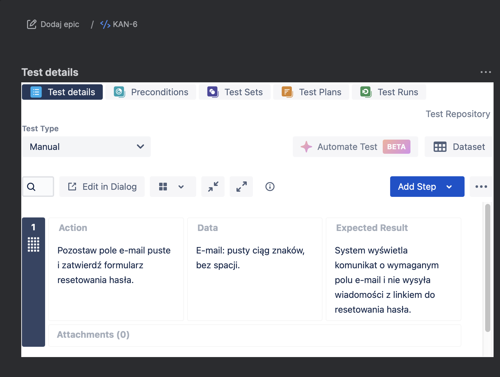
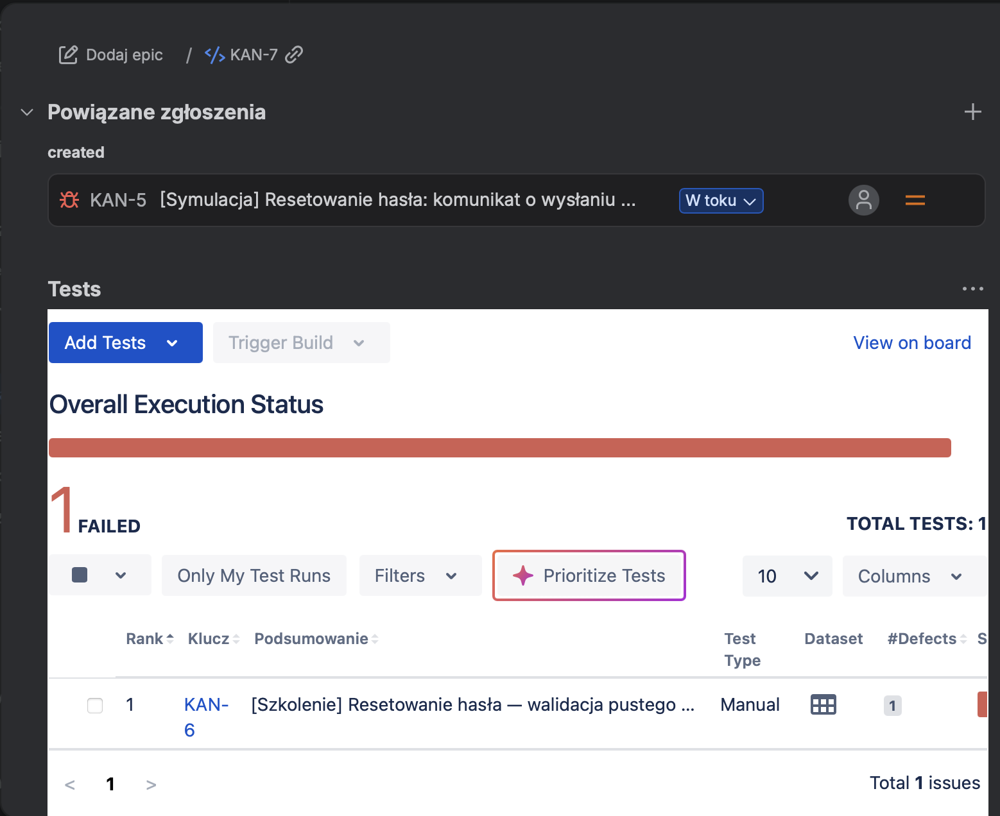
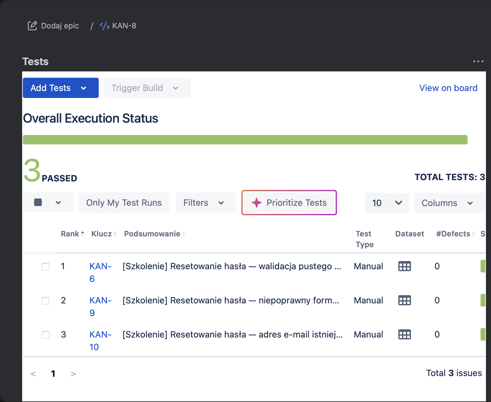

# Jira/Xray — Test Management Practice

A training exercise demonstrating test and defect management for an email password-reset feature.

**All test execution results and defect-fix scenarios are simulated. No real password-reset application was tested.**

This repository focuses on Jira/Xray tool practice using a password-reset training user story.

## Test Basis

The training user story (KAN-4) defines three acceptance criteria:

- An existing account email results in a reset link and a sending confirmation.
- An invalid email format results in a validation message and no email being sent.
- An empty email field results in a required-field message and no email being sent.

## Activities

- Prepared three manual tests with actions, data, and expected results.
- Linked the tests to the user story.
- Organized tests and executions in a Test Plan.
- Recorded a simulated FAILED result and linked it to a defect.
- Practiced confirmation and regression testing using a simulated post-fix execution.

## Artifacts

| Key | Artifact | Purpose |
|---|---|---|
| KAN-4 | User story | Training acceptance criteria |
| KAN-6 | Manual test | Empty email field |
| KAN-9 | Manual test | Invalid email format |
| KAN-10 | Manual test | Existing account email |
| KAN-5 | Defect | Simulated sending confirmation despite an empty email field |
| KAN-7 | Test Execution | Simulated pre-fix execution: KAN-6 FAILED, linked to KAN-5 |
| KAN-8 | Test Execution | Simulated post-fix execution: KAN-6, KAN-9, and KAN-10 PASSED |
| KAN-11 | Test Plan | Groups the three tests and the two executions |

## Selected Evidence

### 1. Manual test definition — KAN-6

The manual test specifies the action, an empty email value without spaces, and the expected required-field message with no reset email being sent.

### 2. Simulated failed execution and linked defect — KAN-7

The execution contains one FAILED test and a link to the simulated defect KAN-5.

### 3. Simulated confirmation and regression testing — KAN-8

KAN-6 represents confirmation testing of the empty-field scenario. KAN-9 and KAN-10 represent regression checks for the other acceptance criteria. All three results are simulated PASSED.

## Workflow Note

KAN-5 appears as **In Progress** in the screenshot because the exercise also included a separate alternative failed-retest scenario, KAN-13. That alternative does not overwrite the PASSED results in KAN-8 and is not presented as the next event after a successful fix.

Jira issue workflow status and Xray test result have different meanings: a completed Test Execution can contain FAILED test results.

## Skills Demonstrated

- Manual test documentation in Xray
- Test Plan and Test Execution organization
- Requirement, test, and defect traceability
- PASSED/FAILED result recording
- Confirmation and regression workflow practice

## Scope and Limitations

The screenshots demonstrate actual use of Jira/Xray with simulated application behavior. They do not prove that a reset email was sent, that a real defect was fixed, or that this was a commercial QA project.

The Jira interface and test steps are in Polish; this summary is in English.